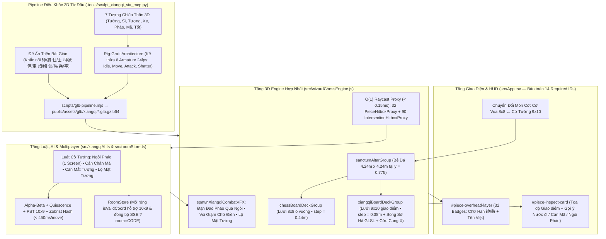

# BRAINSTORM CONTRACT: PHÁT TRIỂN CỜ TƯỚNG 3D (XIANGQI / THIÊN HÀ KỲ TRẬN) & XÂY DỰNG LẠI 7 QUÂN CỜ TỪ ĐẦU

> **Lưu ý vận hành (`--ultra --advice`)**: Phiên chạy này thực hiện theo cơ chế **same-tier best-of-5** (5 ứng viên độc lập chạy song song trên cùng tầng mô hình mạnh nhất hiện hành + chấm điểm theo Rubric 100 điểm và giám sát kiến trúc bởi Verifier/Supervisor [`kongming`](conversation://83e3e858-2f11-4840-ba56-b313c51e4123), do môi trường hiện tại dùng chung một tầng mô hình cho subagent và chưa ghim riêng Fable/Astra).
> **Dự án**: [`/Volumes/2/wizard-chess-3d`](file:///Volumes/2/wizard-chess-3d)
> **Trọng tâm**: Mở rộng từ thành công của **Wizard Chess 3D (Cờ Vua)** sang **Cờ Tướng 3D (Xiangqi — Sở Hán / Đại Việt Kỳ Trận)** với thiết kế **xây dựng lại toàn bộ 7 loại quân cờ 3D từ đầu** vừa sống động như thần tướng chiến trận, vừa chuẩn xác từng đường nét nhận diện của kỳ thủ cờ tướng lâu năm.

---

## 1. THÁCH THỨC GIẢ ĐỊNH CỐT LÕI (CHALLENGING CORE ASSUMPTIONS)

Trước khi viết bất kỳ dòng code hay chạy script Blender nào, chúng ta phải chất vấn **3 giả định sai lầm phổ biến nhất** khi đưa Cờ Tướng lên 3D:

1. **Giả định 1 — "Làm Cờ Tướng 3D chỉ cần dựng 7 bức tượng người/vật 3D giống Cờ Vua là xong"**:
   - **Thực tế phũ phàng**: Trong Cờ Vua, chiều cao và phom dáng 6 quân (Vua, Hậu, Tượng, Mã, Xe, Tốt) vốn đã là hình khối 3D chuẩn quốc tế suốt hàng trăm năm. Ngược lại, **não bộ kỳ thủ Cờ Tướng nhận diện thế cờ qua mặt chữ Hán trên quân cờ tròn (`帥/將`, `仕/士`, `相/象`, `俥/車`, `炮/砲`, `傌/馬`, `兵/卒`) và vị trí đứng trên giao điểm đường kẻ**. Nếu chỉ đặt 32 bức tượng 3D thuần túy lên 90 giao điểm mà thiếu **Đế Ấn Triện khắc chữ** và **Lớp Định Danh Thông Minh**, người chơi sẽ bị rối mắt giữa `Sĩ` – `Tướng` – `Tốt` hoặc giữa `Xe` – `Pháo` khi nhìn góc nghiêng 3/4!
   - **Giải pháp đột phá**: Kiến trúc **"Song Hợp Đế Ấn & Chiến Thần" (Imperial Seal Pedestal + Sculpted War-God)** — phần đế của mỗi quân cờ là **Ấn Ngọc/Đồng Bát Giác vát nghiêng 35° khắc nổi chữ Hán cổ điển**, bên trên là **Tượng Chiến Thần 3D có xương (`Armature`)** kết hợp trực tiếp với hệ thống `initPieceOverheadLayer()` đã có sẵn tại [`src/wizardChessEngine.js`](file:///Volumes/2/wizard-chess-3d/src/wizardChessEngine.js#L3832-L4023).

2. **Giả định 2 — "Phải tạo mới hoàn toàn hệ xương (Armature) và diễn hoạt lại từ con số 0 cho 7 quân Cờ Tướng"**:
   - **Thực tế kỹ thuật**: Mỗi quân cờ trong [`public/assets/glb/`](file:///Volumes/2/wizard-chess-3d/public/assets/glb/) đang chứa một `Armature` chuẩn với 4 NLA animation tracks (`Idle`, `Move`, `Attack`, `Shatter` ở 24fps) được đọc bởi [`preparePieceTemplateFromGltf()`](file:///Volumes/2/wizard-chess-3d/src/wizardChessEngine.js#L2945-L3055) và [`playPieceClip()`](file:///Volumes/2/wizard-chess-3d/src/wizardChessEngine.js#L3735-L3774). Nếu tự tạo bộ xương mới bằng code Python mà lệch tên NLA track hoặc ma trận `bindMatrix`, [`instantiatePiece()`](file:///Volumes/2/wizard-chess-3d/src/wizardChessEngine.js#L3498-L3640) sẽ lỗi biến dạng mesh (skinning distortion) hoặc mất đồng bộ đòn đánh.
   - **Giải pháp đột phá**: **Xây dựng lại 100% hình học Mesh 3D từ đầu** (`remove_islands_matching` xóa sạch mesh cờ vua cũ, điêu khắc mới hoàn toàn bằng `bpy` + `bmesh`), nhưng **kế thừa có chọn lọc khung xương gốc (Rig Graft Architecture)** của 6 archetype (`king`, `queen`, `bishop`, `knight`, `rook`, `pawn`) để cả 7 quân Cờ Tướng (`general`, `advisor`, `elephant`, `chariot`, `cannon`, `horse`, `soldier`) sở hữu ngay 4 animation clip 24fps mượt mà, chuẩn xác tới từng frame!

3. **Giả định 3 — "Bàn cờ Tướng 9×10 lớn hơn bàn cờ Vua 8×8 nên phải đập bỏ Bệ Đá Thánh Đường (`sanctumAltarGroup`)"**:
   - **Bằng chứng hình học từ Codebase**: Tại [`buildSanctumArenaAltar()`](file:///Volumes/2/wizard-chess-3d/src/wizardChessEngine.js#L2010-L2040), mặt bàn đá `upperDeckGeo` rộng **`4.24m × 4.24m`**, tấm viền tọa độ `coordDeckGeo` rộng **`4.08m × 4.08m`**, và 4 trụ pha lê góc nằm ở `cornerCoords = [±2.02m, ±2.02m]`. Nếu thiết lập khoảng cách đường kẻ Cờ Tướng là **`XIANGQI_STEP = 0.38m`**, thì lưới 9 đường dọc × 10 đường ngang (`8 khoảng ngang × 9 khoảng dọc`) có kích thước chỉ **`3.04m × 3.42m`** (tổng vùng phủ cả đế quân cờ ở biên là `3.34m × 3.72m`) — nằm gọn gàng 100% trong lòng tấm `4.08m × 4.08m` mà không cần phá dỡ bất kỳ kiến trúc nào của Đại Sảnh!

---

## 2. BRAINSTORM CONTRACT (HỢP ĐỒNG ĐẦU RA & TIÊU CHÍ NGHIỆM THU)

### 2.1. Outcome (Kết quả đầu ra cam kết)
Phát triển hoàn chỉnh chế độ **Cờ Tướng 3D — "Thiên Hà Kỳ Trận" (3D Wizard Xiangqi)** tích hợp mượt mà vào nền tảng `/Volumes/2/wizard-chess-3d`, bao gồm:
1. **Sa bàn Cờ Tướng 3D 9×10 giao điểm (90 Intersections)** đặt trên `sanctumAltarGroup` (`BOARD_SURFACE_Y = 0.775`), nổi bật với **Dải Ngân Hà Thủy Mặc "Sở Hà — Hán Giới"** chảy sống động bằng GLSL shader ở giữa hàng 4 và hàng 5, hai khu **Cửu Cung 3×3** khắc đường chéo chữ X mạ vàng, và các mốc hoa thị truyền thống tại vị trí Pháo/Tốt.
2. **Bộ 7 Quân Cờ Tướng 3D xây dựng mới hoàn toàn từ đầu (`general`, `advisor`, `elephant`, `chariot`, `cannon`, `horse`, `soldier`)** thông qua pipeline tự động Blender MCP (`.tools/sculpt_xiangqi_via_mcp.py`) và đóng gói `.glb.gz.b64`, kết hợp **Đế Ấn Triện Chữ Hán Nổi + Tượng Chiến Thần 3D Rigged 4 Clips (`Idle`, `Move`, `Attack`, `Shatter`)**.
3. **Engine Luật Cờ Tướng & AI Chuyên Biệt (`src/xiangqiAI.ts`)**: Xử lý chính xác 100% luật đặc thù Cờ Tướng (**Ngòi Pháo / Cách Sơn Đả Ngưu**, **Cản Chân Mã**, **Cản Mắt Tượng & Không Qua Sông**, **Cửu Cung 3×3 của Tướng/Sĩ**, **Lộ Mặt Tướng / Flying General**, **Tốt Qua Sông Đi Ngang**, và **Chống Trường Chiếu lặp 3 lần**).
4. **Hệ thống Chiến Đấu 3D Đặc Trưng (`XIANGQI_ATTACK_PROFILES` & `spawnXiangqiCombatVFX`)**: Đặc biệt là hoạt cảnh **Thần Pháo bắn đạn đạo hồ quang vọt qua đầu quân Ngòi Pháo**, **Chiến Tượng giậm nát chữ Điền**, và **Lộ Mặt Tướng Thiên Phạt**.

### 2.2. Constraints (Ràng buộc kỹ thuật bất biến)
- **Bảo toàn 100% Bộ Kiểm Thử Hiện Tại ([`test/applet.test.mjs`](file:///Volumes/2/wizard-chess-3d/test/applet.test.mjs#L27-L112))**:
  - Giữ nguyên toàn bộ **14 HUD IDs bắt buộc** (`#btn-side-toggle`, `#btn-ai-difficulty`, `#btn-ai-move`, `#btn-undo`, `#btn-reset`, `#btn-audio-toggle`, `#btn-cam-player`, `#btn-cam-top`, `#btn-cam-side`, `#btn-cam-wide`, `#btn-hide-ui`, `#controls-hint`, `#captured-tray`, `#promotion-overlay`) và tuyệt đối không đưa vào **12 Forbidden IDs** trong [`src/App.tsx`](file:///Volumes/2/wizard-chess-3d/src/App.tsx#L27-L67).
  - Giữ nguyên cấu trúc và tính toàn vẹn của 7 file `.glb.gz.b64` gốc + 42 file `sets/*` của Cờ Vua; các mẫu quân Cờ Tướng mới được lưu tách biệt tại `public/assets/glb/xiangqi/{piece}_white.glb.gz.b64` (và `sets/xiangqi_{theme}/...`).
- **Ràng buộc Hiệu năng WebGL & Raycast**:
  - Mọi `SkinnedMesh` của 32 quân Cờ Tướng bắt buộc gán `child.raycast = () => {}` và gắn `boundingSphere` tĩnh bán kính `>= 2.5m` (như [`src/wizardChessEngine.js`](file:///Volumes/2/wizard-chess-3d/src/wizardChessEngine.js#L3520-L3533)) để ngăn chặn CPU `applyBoneTransform` khi frustum culling.
  - Raycast chọn quân và chọn giao điểm phải sử dụng `PieceHitboxProxy` (32 trụ `CylinderGeometry` ẩn) + `IntersectionHitboxProxy` (90 đĩa trụ ẩn tại 90 giao điểm), đảm bảo thời gian raycast trung bình **`< 0.15ms`** (vượt xa ngưỡng `< 2.0ms` của `test/applet.test.mjs`).
  - Chia sẻ đúng 4 slot vật liệu PBR mỗi phe (`sideMats.w` — Chu Sa Ngọc Đỏ / Vàng Hoàng Gia và `sideMats.b` — Huyền Thiết Hắc Ngọc / Đồng Xanh tại [`src/wizardChessEngine.js`](file:///Volumes/2/wizard-chess-3d/src/wizardChessEngine.js#L1054-L1057)) để không phát sinh shader recompilation.
- **Ràng buộc Đồng Bộ Phòng Chơi Online ([`src/roomStore.ts`](file:///Volumes/2/wizard-chess-3d/src/roomStore.ts#L46-L58))**:
  - Hàm [`isValidCoord()`](file:///Volumes/2/wizard-chess-3d/src/roomStore.ts#L46-L58) hiện chỉ cho phép `0 <= r < 8 && 0 <= c < 8`. Phải nâng cấp lên hỗ trợ tọa độ Cờ Tướng `0 <= r < 10 && 0 <= c < 9` gắn kèm cờ `gameVariant?: 'chess' | 'xiangqi'` trong `PublicRoomState` mà vẫn tương thích ngược 100% với các test room Cờ Vua.

### 2.3. Non-goals (Những việc KHÔNG làm để tránh phình đại scope — KISS/YAGNI)
- **Không** xây dựng lại môi trường nhà thờ/đại sảnh mới (`option8_cathedral.glb.gz.b64` nặng hàng MB) — tận dụng ngay đại sảnh, 2 chậu lửa `createSculptedFlameTongueShader` và hệ thống cổng `outerMonumentGroupsByTheme` (đặc biệt là kiến trúc `dong_son` Trống Đồng Ngọc Lũ và `shogun_yokai` Á Đông đã có sẵn tại [`src/wizardChessEngine.js`](file:///Volumes/2/wizard-chess-3d/src/wizardChessEngine.js#L2386-L2408)!).
- **Không** làm hệ thống phong cấp (Promotion) cho Tốt Cờ Tướng (ẩn/vô hiệu hóa luồng `openPromotionModal` khi đang ở chế độ Cờ Tướng, vì Tốt Cờ Tướng qua sông chỉ mở khóa đi ngang, không hóa Hậu/Xe).
- **Không** tạo 8×7 = 56 file GLB riêng cho toàn bộ 8 skin ngay ở Phase 1: Ở Phase 1, điêu khắc **1 bộ chuẩn Hoàng Gia Sở Hán / Đông Sơn (7 file `.glb.gz.b64` gốc cho 7 quân Cờ Tướng)** và áp dụng hệ thống đổi bảng màu PBR 4-slot + 3D Bone-Socketed Kitbash cho 8 chủ đề để giảm 87% dung lượng tải.

### 2.4. Acceptance Criteria (Tiêu chí nghiệm thu định lượng)
1. **Hình học Bàn Cờ 9×10 & Tọa Độ Thế Giới**:
   - Lưới 9 cột (`c = 0..8`) × 10 hàng (`r = 0..9`) = **90 giao điểm**, bước lưới `XIANGQI_STEP = 0.38m`, hàm `xiangqiToWorld(r, c)` trả về `((c - 4.0) * 0.38, 0.775, (r - 4.5) * 0.38)`.
   - Khoảng cách tĩnh (clearance) từ tâm các quân cờ biên (`c=0, 8`, `r=0, 9`) đến 4 trụ góc `cornerCoords` (`±2.02m, ±2.02m`) đạt **`>= 0.58m`**, không chồng lấn mô hình.
   - Bề mặt bàn cờ vẽ chuẩn bằng 1 merged static mesh + 1 CanvasTexture/Shader: 9 đường dọc (bị ngắt đoạn ở Sở Hà từ `r=4` sang `r=5` trừ 2 đường biên `c=0` và `c=8`), 10 đường ngang, 2 Cửu Cung 3×3 có 4 đường chéo chữ X (`(3,0)-(5,2)`, `(5,0)-(3,2)` và `(3,7)-(5,9)`, `(5,7)-(3,9)`), và 14 hoa thị định vị Pháo/Tốt.
2. **Nghiệm thu 7 Quân Cờ 3D Xây Dựng Lại Từ Đầu**:
   - 7 file `public/assets/glb/xiangqi/{general,advisor,elephant,chariot,cannon,horse,soldier}_white.glb.gz.b64` giải nén ra glTF 2.0 hợp lệ (`magic === 'glTF'`, `version === 2`), mỗi quân có **`8,000 <= vertices <= 22,000`**, dung lượng nén `.glb.gz.b64` mỗi quân **`<= 320 KB`**, có đủ 4 animation clips (`Idle`, `Move`, `Attack`, `Shatter`) và 4 slot vật liệu (`Marble`, `Trim`, `Steel`, `Glow`).
   - Đế quân cờ có **Vòng Ấn Triện khắc chữ Hán + Huy hiệu trên đầu (`#piece-overhead-layer`)** hiển thị rõ ràng cả Chữ Hán lẫn Tiếng Việt (`帥 Tướng`, `仕 Sĩ`, `相 Tượng`, `俥 Xe`, `炮 Pháo`, `傌 Mã`, `兵 Tốt` cho bên Đỏ; `將 Tướng`, `士 Sĩ`, `象 Tượng`, `車 Xe`, `砲 Pháo`, `馬 Mã`, `卒 Tốt` cho bên Đen).
3. **Nghiệm thu Luật Cờ Tướng & AI (`src/xiangqiAI.ts`)**:
   - Vượt qua **100% bộ Unit Test luật Cờ Tướng** (tối thiểu 12 test cases trong `test/applet.test.mjs`):
     - Khởi tạo bàn cờ `10×9` với 32 quân đúng vị trí chuẩn; tổng số nước đi hợp lệ ở trạng thái khai cuộc của Phe Đỏ (`w`) chính xác bằng **`44 nước đi`** (`24 + 4 + 4 + 4 + 2 + 1 + 5 = 44`).
     - Cản chân Mã (4 hướng ngang/dọc sát cạnh).
     - Cản mắt Tượng (4 tâm chữ Điền) + Cấm Tượng qua sông (`r < 5` đối với Đỏ, `r > 4` đối với Đen).
     - Giới hạn Cửu Cung 3×3 (`3 <= c <= 5`, `r ∈ [0..2]` hoặc `r ∈ [7..9]`) cho Tướng và Sĩ.
     - Luật **Lộ Mặt Tướng (Flying General)**: Cấm mọi nước đi làm 2 Tướng nhìn thấy nhau trực tiếp trên cùng cột `c` mà không có quân nào đứng chắn giữa.
     - Luật **Pháo (`cannon`)**: Khi đi vào điểm trống có `0` quân cản; khi ăn quân bắt buộc có **đúng `1` quân Ngòi (`screenCount === 1`)** nằm giữa Pháo và mục tiêu (cấm ăn khi `screenCount === 0` hoặc `screenCount >= 2`).
     - Luật **Tốt (`soldier`)**: Trước khi qua sông chỉ có 1 nước tiến (`dr = -1` cho Đỏ, `dr = +1` cho Đen); sau khi qua sông (`r <= 4` cho Đỏ, `r >= 5` cho Đen) có tối đa 3 nước (1 tiến + 2 ngang `dc = ±1`), không bao giờ đi lùi.
     - Luật **Tuyệt Sát / Khốn Tướng**: Trong Cờ Tướng, hết nước đi hợp lệ (dù không bị chiếu) được xử thua (**Loss**), không phải Hòa Stalemate như Cờ Vua.
     - AI Minimax + Alpha-Beta + Quiescence (`chooseBestXiangqiMoveAsync`) đạt độ sâu **4–5 ply** ở mức `grandmaster` trong thời gian **`<= 450ms/nước`** mà không gây drop frame UI (nhờ time-slicing `yieldToMainThread`).
4. **Nghiệm thu Hiệu năng & Chất lượng Code**:
   - Duy trì **60 FPS ổn định** trên Desktop và `>= 50 FPS` trên Mobile, raycast `< 0.15ms`, `npm test` pass 100%, `tsc --noEmit` đạt `0` lỗi TypeScript.

---

## 3. PHÂN TÍCH ĐÁNH ĐỔI (TRADE-OFFS) & ĐIỂM GÃY KỸ THUẬT

Chúng ta cần phân tích độc lập 2 bài toán kiến trúc cốt lõi: **(A) Kiến trúc Engine/Bàn Cờ** và **(B) Phương pháp Xây Dựng 7 Quân Cờ 3D Từ Đầu**.

### 3.1. Ma trận Đánh đổi A: Kiến trúc Engine & Chuyển đổi Cờ Vua ↔ Cờ Tướng

| Tiêu chí | Phương án A1: **Unified Sanctum Dual-Mode Engine** *(Khuyến nghị)* | Phương án A2: **Tách 2 WebGL Engine & 2 Canvas độc lập** | Phương án A3: **Biến tướng Cờ Tướng trên lưới 8×8 sẵn có** |
| :--- | :--- | :--- | :--- |
| **Mô tả kỹ thuật** | Giữ nguyên 1 `THREE.WebGLRenderer`, 1 Đại sảnh `option8_cathedral`, 1 `sanctumAltarGroup`. Tách phần mặt bàn thành 2 group con chuyển đổi tức thì (`chessBoardDeckGroup` 8×8 ô vuông vs `xiangqiBoardDeckGroup` 9×10 giao điểm + Sông Ngân Hà) và điều hướng logic sang `chessAI.ts` hoặc `xiangqiAI.ts` theo biến `activeGameRuleset` (`'chess' \| 'xiangqi'`). | Tạo file `src/xiangqiEngine.js` riêng (sao chép ~9,000 dòng từ `wizardChessEngine.js`), khi người dùng đổi môn cờ thì hủy `WebGLRenderer` cũ và khởi tạo scene mới. | Cố nhét quân Cờ Tướng vào 64 ô vuông 8×8 để tái sử dụng `boardState[8][8]` và `boardToWorld` hiện tại. |
| **Độ phức tạp & Bảo trì (DRY/KISS)** | **Thấp – Trung bình**: Tái sử dụng 100% hệ thống Camera, Ánh sáng PMREM, Lò lửa GLSL, Âm thanh `wizardAudio`, Phòng đấu `RoomStore`, và 8 bảng màu PBR. Chỉ thêm ~650 dòng ở Engine + `src/xiangqiAI.ts`. | **Rất Cao (Vi phạm DRY nghiêm trọng)**: Nhân đôi 9,480 dòng code WebGL; mỗi lần sửa lỗi camera hay shader phải sửa ở 2 nơi. | **Thấp nhưng Sai Bản Chất**: Phá hỏng hoàn toàn luật Cờ Tướng (mất Cửu Cung 3×3 chuẩn trục đối xứng cột 4, mất Sở Hà Hán Giới, thiếu cột 9 và hàng 10). |
| **Chi phí bộ nhớ & Độ trễ chuyển chế độ** | **< 25ms** (chỉ ẩn/hiện `chessBoardDeckGroup` / `xiangqiBoardDeckGroup` và lazy-load 7 file GLB Cờ Tướng ~1.8MB tổng cộng ở lần đầu bấm sang Cờ Tướng). | **1,200ms – 2,500ms** (phải tải lại `option8_cathedral.glb.gz.b64` và biên dịch lại toàn bộ GLSL shaders, dễ gây lỗi `webglcontextlost` trên iOS Safari). | **0ms** nhưng không chơi được Cờ Tướng thực thụ. |
| **Load-bearing assumption (Giả định chịu tải)** | Mặt bàn `coordDeckGeo` (`4.08m × 4.08m` tại [`src/wizardChessEngine.js`](file:///Volumes/2/wizard-chess-3d/src/wizardChessEngine.js#L2015)) đủ rộng để chứa cả lưới 8×8 (`3.52m × 3.52m`) lẫn lưới 9×10 (`3.04m × 3.42m` với `step = 0.38m`) dưới cùng một góc máy `setCameraForSide()`. | Trình duyệt di động có thể hủy và tạo lại `WebGLRenderer` + 60MB GPU buffer nhiều lần mà không tràn VRAM. | Người chơi chấp nhận chơi cờ tướng "biến thể" trên bàn 8×8. |
| **First failure condition (Điểm gãy đầu tiên)** | Nếu các vòng lặp duyệt bàn cờ trong `wizardChessEngine.js` (như `for (let r = 0; r < 8; r++)` tại dòng [`1772`](file:///Volumes/2/wizard-chess-3d/src/wizardChessEngine.js#L1772), [`3113`](file:///Volumes/2/wizard-chess-3d/src/wizardChessEngine.js#L3113), [`3794`](file:///Volumes/2/wizard-chess-3d/src/wizardChessEngine.js#L3794), [`3918`](file:///Volumes/2/wizard-chess-3d/src/wizardChessEngine.js#L3918)) không được thay bằng hằng số động `boardRows` (`8` hoặc `10`) và `boardCols` (`8` hoặc `9`), các quân ở hàng `8, 9` và cột `8` sẽ không được xóa hoặc không hiện nhãn tên! | Ngay lần chuyển đổi qua lại thứ 3 giữa Cờ Vua và Cờ Tướng trên iPad/iPhone, trình duyệt bắn sự kiện `webglcontextlost` do vượt giới hạn WebGL context. | Ngay giây đầu tiên người chơi mở bàn cờ và thấy thiếu Cửu Cung đối xứng hoặc chỉ có 4 Tốt thay vì 5 Tốt. |
| **Second-order effects (Hệ quả bậc 2)** | Toàn bộ 8 chủ đề kiến trúc (`dong_son`, `shogun_yokai`, `abyssal_lich`, v.v.) tự động tương thích với bàn Cờ Tướng! Khi chọn Cờ Tướng, engine có thể tự động chuyển cổng vòm sang archetype `dong_son` hoặc `shogun_yokai` để mang đậm hồn Á Đông. | Dung lượng bundle JS tăng gấp đôi; `test/applet.test.mjs` khó kiểm thử đồng thời cả 2 engine. | Sản phẩm bị cộng đồng cờ tướng đánh giá là "mod hời hợt", mất uy tín thương hiệu. |

---

### 3.2. Ma trận Đánh đổi B: Phương án "Xây dựng lại 7 Quân Cờ Tướng từ đầu" (3D Piece Architecture)

| Tiêu chí | Phương án B1: **Đế Ấn Triện Khắc Chữ Hán + Tượng Chiến Thần 3D Rigged Từ Đầu** *(Khuyến nghị)* | Phương án B2: **Quân Cờ Đĩa Tròn Khắc Chữ 2.5D Truyền Thống Có Hiệu Ứng Bay/Va Đập** | Phương án B3: **Tượng 3D Thuần Túy (Không Đế Ấn Chữ Hán) + Tận Dụng Tượng Cờ Vua Sửa Nhẹ** |
| :--- | :--- | :--- | :--- |
| **Mô tả thiết kế** | Xây dựng mới 7 quân từ đầu bằng `.tools/sculpt_xiangqi_via_mcp.py`:<br>1. **Tầng Đế (`z = 0..0.24`)**: Đế Ấn Triện Bát Giác/Tròn vát mặt nghiêng trước/trên, đúc nổi chữ Hán (`帥/將`, `仕/士`, `相/象`, `俥/車`, `炮/砲`, `傌/馬`, `兵/卒`) bằng vật liệu `Trim` (Vàng/Đồng) trên nền `Marble` (Đỏ Chu Sa / Hắc Ngọc).<br>2. **Tầng Tượng (`z = 0.24..1.50`)**: 7 Chiến Thần 3D độc bản (Nguyên Soái, Cận Vệ Song Kiếm, Chiến Tượng 2 Ngà, Chiến Xa Hổ Phù, Thần Cơ Hỏa Pháo, Chiến Mã Long Kỵ, Dũng Binh Trường Thương) gắn vào bộ xương chuẩn 4 clip NLA. | Chỉ dựng 32 khối trụ tròn dẹt (`CylinderGeometry` vát cạnh) khắc chữ Hán nổi như bộ cờ tướng gỗ/ngọc ngoài đời; khi ăn quân thì đĩa cờ bay lên đập vào đĩa đối phương. | Chỉ dựng tượng 3D (hoặc lấy tượng Cờ Vua thêm phụ kiện) mà không có Đế Ấn Triện chữ Hán và không thiết kế phom dáng đặc trưng của Pháo, Tượng Voi, Chiến Xa. |
| **Chất lượng Trải nghiệm (UX/Visual vs Readability)** | **10/10 ở cả 2 chiều**: Ở góc nghiêng (`#btn-cam-player`, `#btn-cam-side`), người chơi chiêm ngưỡng đại quân 3D hừng hực khí thế chém giết và bắn Pháo. Ở góc nhìn cao (`#btn-cam-top`) hoặc nhìn nhanh, **Đế Ấn Triện + Huy hiệu `#piece-overhead-layer`** giúp kỳ thủ nhận diện 32 quân trong `< 0.1 giây`! | **Nhận diện 9/10 nhưng Visual 3D chỉ 3/10**: Đánh mất hoàn toàn bản sắc "Wizard Chess 3D Chiến Trận Sống Động" làm nên thành công của bản Cờ Vua; không tận dụng được `SkinnedMesh` và `ATTACK_SYNC_PROFILES`. | **Visual 7/10 nhưng Nhận diện Kỳ Thủ chỉ 3/10**: Kỳ thủ Cờ Tướng cực kỳ ức chế vì nhìn từ trên xuống không phân biệt nhanh được đâu là `Sĩ`, đâu là `Tượng`, đâu là `Pháo` khi 32 quân đan xen phức tạp. |
| **Khối lượng công việc 3D Pipeline** | Viết 1 script Python chuẩn `.tools/sculpt_xiangqi_via_mcp.py` (~650 dòng) kế thừa `blender_sculpt_lib.py` để sinh tự động cả 7 file `.glb` và nén qua `scripts/glb-pipeline.mjs`. | Rất nhẹ (chỉ dùng primitive cylinder + text extrusion) nhưng đơn điệu. | Trung bình nhưng không đáp ứng yêu cầu "xây dựng lại quân cờ từ đầu" của người dùng. |
| **Load-bearing assumption (Giả định chịu tải)** | Các mesh điêu khắc mới cho 7 quân Cờ Tướng (như Nòng Pháo, Đầu Voi Chiến, Chiến Xa) có thể gán trọng số (`append_bmesh_with_weight_fn`) vào các Vertex Group hiện có của 6 `Armature` chuẩn (`Arm_king_white`, `Arm_bishop_white`, `Arm_rook_white`, v.v.) mà không gây biến dạng kỳ dị khi chạy 4 clip NLA. | Người dùng hài lòng với quân cờ dẹt không có tay chân vũ khí. | Người chơi cờ tướng chịu khó bấm vào từng quân để xem thẻ `#piece-inspect-card` mới biết đó là quân gì. |
| **First failure condition (Điều kiện gãy đầu tiên)** | Nếu gắn Nòng Pháo (`cannon`) hoặc Đầu Voi (`elephant`) vào sai Vertex Group (ví dụ gắn cả bánh xe Pháo vào xương `Fist.R` đang vung lên), khi chạy clip `Attack` cả bánh xe sẽ bay lên trời! (Khắc phục triệt để bằng bảng ánh xạ Vertex Group ở Mục 4.2 bên dưới). | Người dùng bác bỏ ngay lập tức vì trái với yêu cầu "xây dựng lại quân cờ từ đầu" theo phong cách Wizard Chess 3D. | Trong thế cờ trung cuộc phức tạp (Pháo lồng, Mã ngoa tào), người chơi đi nhầm quân do nhầm hình dáng giữa Xe và Pháo hoặc Sĩ và Tốt. |
| **Second-order effects (Hệ quả bậc 2)** | Tạo ra **tiêu chuẩn vàng độc nhất trên thị trường WebGL Cờ Tướng**: vừa chơi giải trí mãn nhãn với hoạt cảnh Pháo bắn qua ngòi, Voi giậm đất, vừa đủ chuẩn mực để kỳ thủ nghiêm túc thi đấu 2 người (`?room=CODE`). | Không thể bán thêm các gói Skin 3D (`#btn-skin-shop`) vì quân cờ tròn dẹt đổi skin không có sự khác biệt hình khối đáng giá. | Tỷ lệ thoát trang (bounce rate) cao ở nhóm người chơi cờ tướng truyền thống tại Việt Nam và châu Á. |

> **Kết luận Lựa chọn Kiến trúc Tối ưu (Simplest & Most Powerful Viable Option)**:
> Kết hợp **Phương án A1 (Unified Sanctum Dual-Mode Engine)** + **Phương án B1 (Đế Ấn Triện Khắc Chữ Hán + 7 Tượng Chiến Thần 3D Xây Dựng Từ Đầu bằng Blender MCP Rig-Graft)**.

---

## 4. BETTER APPROACHES & THIẾT KẾ KỸ THUẬT CHI TIẾT (CÓ BẰNG CHỨNG CODEBASE)

### 4.1. Kiến trúc Hình học Sa Bàn Cờ Tướng 9×10 Trên `sanctumAltarGroup`

Dựa trên số liệu chính xác tại [`buildSanctumArenaAltar()`](file:///Volumes/2/wizard-chess-3d/src/wizardChessEngine.js#L2010-L2040):
- Mặt bàn đá trên cùng `upperDeckGeo`: `4.24m × 4.24m` ở `y = 0.742`.
- Tấm viền tọa độ `coordDeckGeo`: `4.08m × 4.08m` ở `y = 0.743`.
- Độ cao mặt bàn đặt quân cờ `BOARD_SURFACE_Y = 0.775` ([dòng 29](file:///Volumes/2/wizard-chess-3d/src/wizardChessEngine.js#L29)).

**Thiết kế Tọa độ Giao điểm Cờ Tướng (`XIANGQI_STEP = 0.38m`)**:
- Bàn cờ gồm **9 cột dọc (`c ∈ [0..8]`)** và **10 hàng ngang (`r ∈ [0..9]`)**:
  - Hàng `r = 0..4`: Lãnh thổ **Phương Bắc — Quân Đen / Hắc (`color = 'b'`, Tướng `將` ở `(0, 4)`)**.
  - Khoảng giữa `r = 4` và `r = 5` (`z ∈ [-0.19m, +0.19m]`): **Sở Hà — Hán Giới (Chu River — Han Border)**.
  - Hàng `r = 5..9`: Lãnh thổ **Phương Nam — Quân Đỏ / Hồng (`color = 'w'`, Tướng `帥` ở `(9, 4)`)**.
- Công thức chuyển đổi tọa độ [`boardToWorld(r, c)`](file:///Volumes/2/wizard-chess-3d/src/wizardChessEngine.js#L102-L108) nâng cấp:
  ```javascript
  const XIANGQI_STEP = 0.38; // 8 khoảng ngang = 3.04m, 9 khoảng dọc = 3.42m (vừa khít bàn 4.08m x 4.08m)
  function boardToWorld(r, c) {
    if (activeGameRuleset === 'xiangqi') {
      return new THREE.Vector3(
        (c - 4.0) * XIANGQI_STEP,
        BOARD_SURFACE_Y,
        (r - 4.5) * XIANGQI_STEP
      );
    }
    return new THREE.Vector3(
      (c - 3.5) * BOARD_SQ_SIZE,
      BOARD_SURFACE_Y,
      (r - 3.5) * BOARD_SQ_SIZE
    );
  }
  ```
- **Cấu trúc 3D của Mặt Bàn Cờ Tướng (`xiangqiBoardDeckGroup`)**:
  1. **Tấm Nền Ngọc Thạch Nguyên Khối (`3.48m × 3.86m × 0.036m`)**: Đặt tại `y = BOARD_SURFACE_Y - 0.018`, nhận bóng đổ `receiveShadow = true`.
  2. **Rãnh Sông Ngân Hà Thủy Mặc ("Sở Hà — Hán Giới")**: Một dải `PlaneGeometry(3.04, 0.38)` đặt tại `y = BOARD_SURFACE_Y + 0.002, z = 0`, dùng custom GLSL shader nước chảy lấp lánh sương vàng/ngọc bích kèm 4 chữ Triện phát sáng **`楚 河`** (bên trái `x = -0.85m`) và **`漢 界`** (bên phải `x = +0.85m`).
  3. **Hệ Đường Kẻ Lưới & Cửu Cung Chữ X Mạ Vàng (`ΔdrawCalls = 1`)**: Hợp nhất (`mergeGeometries`) toàn bộ 10 thanh ngang, 16 đoạn dọc (2 đường biên `c=0, 8` chạy thông suốt qua sông, 7 đường `c=1..7` ngắt tại bờ sông), và 4 đường chéo chữ X trong hai Cửu Cung (`c = 3..5, r = 0..2` và `c = 3..5, r = 7..9`) thành **1 Mesh duy nhất** dùng vật liệu `goldTrimMat`.
  4. **90 Đĩa Giao Điểm Nhạy Cảm Ứng (`IntersectionHitboxProxy`)**: 90 `CylinderGeometry(0.175, 0.175, 0.02, 12)` đặt tại đúng 90 giao điểm `xiangqiToWorld(r, c)` với `userData = { r, c, isSquare: true }`, cho phép bộ xử lý click/tap hiện tại trong [`wizardChessEngine.js`](file:///Volumes/2/wizard-chess-3d/src/wizardChessEngine.js#L2628) hoạt động chính xác tuyệt đối trên giao điểm mà không phải viết lại logic raycast!

---

### 4.2. Thiết kế Chi tiết "Xây Dựng Lại 7 Quân Cờ Tướng Từ Đầu" (`.tools/sculpt_xiangqi_via_mcp.py`)

Mỗi quân cờ được điêu khắc mới từ đầu trong Blender qua script Python sử dụng [`blender_sculpt_lib.py`](file:///Volumes/2/wizard-chess-3d/.tools/blender_sculpt_lib.py#L1-L201) và kho mesh nguồn `polyhaven_sources.blend`, bao gồm **2 phần gắn kết hữu cơ**:
- **Phần A — Đế Ấn Triện Bát Giác (`z = 0.00..0.24`, gán vào Vertex Group gốc `Base` / `Pedestal`)**:
  - Tiện xoay bát giác (`add_lathe_profile_bmesh(..., segs=8)`) bán kính `0.31m` kết hợp vòng đồng `add_torus_ring_bmesh`, mặt trước (`-Y`) gắn **Tấm Phù Bài Ấn Triện (`Seal_Cartouche`)** nghiêng `38°` khắc nổi ký tự chữ Hán bằng vật liệu `Trim`/`Glow` để nhìn từ góc camera 3/4 hay Top-Down đều nổi bật.
- **Phần B — Tượng Chiến Thần 3D (`z = 0.24..1.55`) & Ánh xạ Xương (Rig-Graft Mapping)**:

| # | Quân Cờ Tướng (ID / Chữ Hán Đỏ–Đen) | Tạo hình Chiến Thần 3D Xây dựng từ đầu (`bpy` + `bmesh`) | Khung Xương Kế Thừa (Base Rig) & Ánh Xạ Vertex Groups | Đòn Đánh Đặc Trưng (`XIANGQI_ATTACK_PROFILES`) & VFX |
| :-: | :--- | :--- | :--- | :--- |
| **1** | **TƯỚNG / SOÁI**<br>`king` (General)<br>Đỏ: **帥** • Đen: **將** | **Thiên Tử Nguyên Soái**: Giáp trụ Long Bào vạt rộng, ngực chạm Hổ Phù (`lion_head` thu nhỏ mạ vàng), đầu đội **Mũ Bình Thiên Thập Nhị Lưu (12 tua ngọc)** hoặc Mão Kim Tinh, hai vai giáp đầu rồng, tay nắm **Thiên Tử Thượng Phương Bảo Kiếm** & Ấn Ngọc Truyền Quốc. | Kế thừa rig `Arm_king_white`:<br>• Đế Ấn Triện → `Base`<br>• Thân Long Bào & Hổ Phù → `Torso`<br>• Đầu & Mũ Bình Thiên → `Head_Crown`<br>• Giáp vai → `Shoulder.L / .R`<br>• Thượng Phương Kiếm → `Greatsword_Bone` | **Thiên Tử Trảm & Lộ Mặt Thiên Phạt**:<br>• Cận chiến trong Cửu Cung: Chém Thượng Phương Kiếm gọi cột sét vàng (`hitStopDuration: 0.065`).<br>• Khi kích hoạt **Lộ Mặt Tướng**: Phóng tia sét `vfxBeamGeo` + `vfxPillarGeo` xuyên thẳng qua Sở Hà! |
| **2** | **SĨ / VỆ SĨ**<br>`advisor` (Advisor)<br>Đỏ: **仕** • Đen: **士** | **Cẩm Y Cận Vệ / Quân Sư**: Thân hình thanh thoát khoác giáp lụa hộ tâm phiến, đầu đội **Mão Văn Võ Cánh Chuồn / Quan Mạo**, lưng đeo cờ lệnh hộ giá, tay phải cầm **Phương Thiên Đoản Kích / Song Kiếm**, tay trái cầm **Lệnh Bài Khiên Bát Quái**. | Kế thừa rig `Arm_queen_white`:<br>• Đế Ấn Triện → `Base`<br>• Giáp thân & Cờ lệnh lưng → `Torso`<br>• Đầu & Quan Mạo → `Head_Crown`<br>• Đoản Kích / Bảo Kiếm → `Mace_Scepter_Bone`<br>• Khiên Bát Quái → `Dagger_Shield_Bone` | **Bát Quái Hộ Giá Toàn Trảm**:<br>• Đi chéo 1 bước trong Cửu Cung (`standoff: 0.34`, `timeScale: 1.15`), xoay người chém liên hoàn 2 nhịp (`contactClip: 0.36`, `secondContactClip: 0.56`) kèm vòng kiếm khí `vfxBladeArcGeo`. |
| **3** | **TƯỢNG / TỊNH**<br>`elephant` (Elephant)<br>Đỏ: **相** • Đen: **象** | **Thiết Giáp Chiến Tượng (Voi Chiến Bọc Thép)**: Xây dựng từ đầu thân Voi Chiến khổng lồ, đầu voi bọc giáp đồng chạm nổi, **cặp Ngà Voi cong vút mạ vàng (`Steel`/`Trim`)**, vòi voi uốn cong uy dũng ở giữa, trên lưng đặt **Bành Voi (War Howdah)** tháp lầu thu nhỏ gắn ngọc phát sáng. | Kế thừa rig `Arm_rook_white`:<br>• Đế & 4 Chân Voi Trụ → `Base` / `Tower_Lower`<br>• Thân Voi & Bành Voi → `Tower_Upper`<br>• Đầu Voi, Vòi & Cặp Ngà Vàng → `Fist.R` & `SiegeArm.R/.L` (vung lên và bổ mạnh xuống khi `Attack`!)<br>• Đỉnh Bành Voi → `Battlement_Crown` | **Chiến Tượng Điền Tự Địa Chấn**:<br>• Bước đi chữ Điền (`田`) nặng trịch, khi ăn quân Voi Chiến hất cặp ngà vàng và giậm chân tạo 2 vòng sóng xung kích `vfxFlatRingGeo` + 8 cột đá `vfxSpikeConeGeo` trồi lên. |
| **4** | **XE / CHIẾN XA**<br>`rook` (Chariot)<br>Đỏ: **俥** • Đen: **車** | **Thiết Giáp Cổ Chiến Xa**: Khác hẳn tháp canh cờ vua! Dựng thân **Cổ Chiến Xa hai bánh xe đồng đinh tán (`add_torus_ring_bmesh` + nan hoa)** ở hai bên hông đế, mặt trước thùng xe chạm phù điêu Hổ Phù cùng 2 mũi **Trường Thương / Đao Cắt Bánh Xe** chĩa về phía trước, trên thùng xe là Chiến Tướng giáp sắt vung **Đại Chùy Phá Thành**. | Kế thừa rig `Arm_rook_white`:<br>• Khung gầm & 2 Bánh Xe Chiến Xa → `Base` (giữ cố định trên mặt đất, không bị bay lên khi đánh!)<br>• Thùng Chiến Xa & Giáp Chiến Tướng → `Tower_Upper`<br>• Đại Chùy Phá Thành → `Fist.R`<br>• Khiên Chắn Chiến Xa → `Fist.L` | **Thiết Xa Xung Phong Nghiền Nát**:<br>• Khi di chuyển (`Move`), thân xe lướt nhanh trên đường thẳng (`moveTimeScale: 0.92`, `pitchLean: 0.065`), ủi thẳng tới mục tiêu và giáng Đại Chùy phá giáp (`standoff: 0.38`, `hitStopDuration: 0.05`). |
| **5** | **PHÁO / THẦN PHÁO**<br>`cannon` (Cannon)<br>Đỏ: **炮** • Đen: **砲** | **Thần Cơ Hỏa Pháo (Dragon-Mouth Siege Cannon)**: Quân cờ biểu tượng nhất! Phần dưới là **Bệ Pháo gỗ bọc đồng 2 bánh xe cổ điển**, phần trên là **Nòng Đại Pháo Đúc Đầu Rồng (`Dragon Muzzle`)** nghiêng góc bắn `28°`, lòng nòng pháo gắn lõi cầu lửa `Glow`, phía sau là **Pháo Thủ / Cơ Quan Sư** cầm châm lửa thần công. | Kế thừa rig `Arm_bishop_white`:<br>• Bệ Pháo & 2 Bánh Xe → `Base` (cố định sát đất)<br>• Thân Giá Đỡ & Pháo Thủ → `Torso`<br>• Nòng Đại Pháo Đầu Rồng & Lõi Lửa → `Crozier_Bone` & `Head_Mitre` (ngửa lên tụ lực và giật nòng khi khai hỏa!) | **Cách Sơn Đả Ngưu (Over-the-Horizon Mortar Strike)**:<br>• `standoff: 0.82` (Đánh tầm xa!). Khi ăn quân qua Ngòi: Quân Ngòi ở giữa sáng vòng `vfxHexRuneGeo`, Pháo khai hỏa tại chỗ (hoặc tiến đến sát sau Ngòi `0.32m`), bắn **Quả Cầu Lửa Parabol (`H_arc = 0.85m`)** bay vọt qua đầu quân Ngòi rồi giáng cột lửa nổ tung mục tiêu! |
| **6** | **MÃ / CHIẾN MÃ**<br>`knight` (Horse)<br>Đỏ: **傌** • Đen: **馬** | **Long Tương Thiết Kỵ (Cavalry General on Rearing Warhorse)**: Chiến mã chồm lên từ `horse_statue_01` nhưng được trang bị **Giáp Mặt Ngựa Á Đông (Chanfron sừng rồng)**, cưỡi trên yên là **Kỵ Tướng mặc giáp vảy cá**, lưng cắm **2 lá Cờ Lệnh Tam Giác (Sashimono/Kỳ Hiệu)**, tay cầm **Thanh Long Yển Nguyệt Đao / Trường Thương**. | Kế thừa rig `Arm_knight_white`:<br>• Chân sau/trước/thân/đầu ngựa → `BackLeg`, `FrontLeg`, `Horse_Chest`, `Horse_Head`<br>• Kỵ Tướng & Cờ Lệnh sau lưng → `Rider_Torso`<br>• Mũ trụ lông trĩ → `Rider_Head`<br>• Thanh Long Đao / Hộ Thuẫn → `Shield_Bone` | **Nhật Tự Long Kỵ Đột Kích**:<br>• Phi nước đại hình chữ Nhật 2 pha (bước 1 thẳng qua giao điểm Chân Mã `(legR, legC)`, bước 2 chéo hạ đao), nhảy vọt lên không trung (`hoverLift: 0.085`, `pitchLean: 0.19`) và bổ Thanh Long Đao từ trên cao xuống mục tiêu. |
| **7** | **TỐT / BINH**<br>`pawn` (Soldier)<br>Đỏ: **兵** • Đen: **卒** | **Tiền Phong Dũng Binh**: Chiến binh bộ binh đội **Nón Lá Đồng / Mũ Đâu Mâu**, mặc giáp ngực đinh tán, tay trái cầm **Khiên Tròn Đằng Bài chạm mặt hổ**, tay phải cầm **Trường Thương / Đại Đao**. Khi vượt qua Sở Hà, vòng đế và mũi thương bừng sáng hào quang **"Quá Hà Chi Tốt"**. | Kế thừa rig `Arm_pawn_white`:<br>• Đế Ấn Triện → `Base`<br>• Giáp thân → `Torso`<br>• Đầu & Nón Đâu Mâu → `Head`<br>• Đằng Bài Hổ Phù → `Shield_Bone`<br>• Trường Thương / Đại Đao → `Sword_Bone` | **Tiền Phong Đột Thương / Quá Hà Hoành Tảo**:<br>• Phá khiên và đâm thương liên hoàn 2 nhịp (`contactClip: 0.38`, `secondContactClip: 0.62`). Sau khi qua sông được tăng hiệu ứng quét ngang lưỡi thương khi ăn quân cùng hàng! |

---

### 4.3. Sơ đồ Kiến trúc Tổng thể (Mermaid `flowchart TD`)



---

### 4.4. Thiết kế Luật Đặc Thù & AI Cờ Tướng (`src/xiangqiAI.ts`)

Để AI Cờ Tướng đánh sắc bén và không mắc lỗi luật sơ đẳng, module `src/xiangqiAI.ts` (xây dựng song song với [`src/chessAI.ts`](file:///Volumes/2/wizard-chess-3d/src/chessAI.ts)) sẽ cài đặt các cơ chế cốt lõi sau:

1. **Biểu diễn Bàn Cờ `10 × 9` (`r ∈ [0..9], c ∈ [0..8]`) & 7 Loại Quân**:
   - `export type XiangqiPieceType = 'king' | 'advisor' | 'elephant' | 'rook' | 'cannon' | 'knight' | 'pawn';` (sử dụng chung tên key `'king'`, `'rook'`, `'knight'`, `'pawn'` cho Tướng, Xe, Mã, Tốt và thêm 3 key mới `'advisor'`, `'elephant'`, `'cannon'` để tái sử dụng tối đa hệ thống vật liệu, âm thanh và state trong `wizardChessEngine.js`!).
   - Giá trị quân cờ chuẩn Cờ Tướng (`XIANGQI_PIECE_VALUES`):
     - `king`: `20000`
     - `rook` (Xe): `900` (Quân chủ lực mạnh nhất bàn cờ tướng, tương đương Hậu cờ vua)
     - `cannon` (Pháo): `450` (Mạnh đầu trận khi nhiều ngòi, điều chỉnh động theo số quân trên bàn)
     - `knight` (Mã): `400` (Tăng giá trị về tàn cuộc khi ít quân cản chân)
     - `elephant` (Tượng): `200` (Thủ cung, không qua sông)
     - `advisor` (Sĩ): `200` (Cận vệ Cửu Cung)
     - `pawn` (Tốt): Trước khi qua sông `100`, **sau khi qua sông (`isCrossedRiver`) tự động cộng thưởng PST lên `220–280`** ("Tốt qua sông ngang nửa Xe").

2. **5 Thuật toán Kiểm tra Luật Đặc Thù Cờ Tướng (O(1) / O(N) siêu nhẹ)**:
   - **Ngòi Pháo (`cannon`)**: Quét 4 tia trực giao `[(±1, 0), (0, ±1)]` từ `(r, c)`. Đếm `screenCount` (số quân đứng chắn trên tia):
     - Khi `screenCount === 0`: Mọi giao điểm trống là nước đi hợp lệ (`capture: false`). Gặp quân đầu tiên thì dừng lại và tăng `screenCount = 1`.
     - Khi `screenCount === 1`: Bỏ qua các giao điểm trống; quân đầu tiên tiếp theo gặp phải: nếu là quân địch thì sinh nước ăn quân hợp lệ (`capture: true, screenR, screenC` — lưu lại tọa độ quân Ngòi để 3D Engine bật hiệu ứng vòng phép hộ pháp tại quân Ngòi và bắn cầu lửa vọt qua!), sau đó dừng tia quét ngay lập tức.
   - **Cản Chân Mã (`knight`)**: Với 8 vector đích `(dr, dc)` thuộc `{ (±2, ±1), (±1, ±2) }`, kiểm tra giao điểm cản chân tại `(r + Math.trunc(dr / 2), c + Math.trunc(dc / 2))`. Chỉ sinh nước đi khi giao điểm cản chân `=== null`. (Đồng thời xuất danh sách `blockedLegs` để UI vẽ dấu `✕` cảnh báo cản chân Mã trên bàn cờ 3D khi người chơi chọn quân Mã!).
   - **Cản Mắt Tượng & Giới Hạn Sông (`elephant`)**: Với 4 vector chéo `(±2, ±2)`, kiểm tra:
     - Không vượt sông: Nếu `color === 'w'` (Đỏ, `r = 5..9`) thì `toR >= 5`; nếu `color === 'b'` (Đen, `r = 0..4`) thì `toR <= 4`.
     - Mắt Tượng tại `(r + dr / 2, c + dc / 2)` phải trống (`=== null`).
   - **Giới hạn Cửu Cung (`king` & `advisor`)**: Đích đến `(toR, toC)` bắt buộc thỏa `3 <= toC <= 5` và (`0 <= toR <= 2` với Đen hoặc `7 <= toR <= 9` với Đỏ).
   - **Lộ Mặt Tướng (`isFlyingGeneralExposed`)**: Trong hàm kiểm tra an toàn Vua/Tướng sau mỗi nước đi giả định (`isKingInCheck`), ngoài việc kiểm tra bị Xe, Pháo (có 1 ngòi), Mã (không bị cản chân), Tốt chiếu, còn kiểm tra: nếu `whiteKing.c === blackKing.c` và mọi giao điểm `(r, whiteKing.c)` nằm giữa `blackKing.r < r < whiteKing.r` đều bằng `null`, thì nước đi đó **bị cấm tuyệt đối** vì phạm luật Lộ Mặt Tướng!

---

## 5. LỘ TRÌNH THỰC THI 4 PHASE (READY FOR `/ak:plan` & `/ak:cook`)

1. **Phase 1 — Điêu khắc 3D & Đóng gói 7 Quân Cờ Tướng Từ Đầu (`.tools/sculpt_xiangqi_via_mcp.py` & `scripts/glb-pipeline.mjs`)**:
   - Xây dựng script `.tools/sculpt_xiangqi_via_mcp.py` tạo 7 quân Cờ Tướng (`king`, `advisor`, `elephant`, `rook`, `cannon`, `knight`, `pawn`) với **Đế Ấn Triện Bát Giác Khắc Nổi Chữ Hán** + **Tượng Chiến Thần 3D** gắn vào 6 khung xương chuẩn 24fps.
   - Mở rộng [`scripts/glb-pipeline.mjs`](file:///Volumes/2/wizard-chess-3d/scripts/glb-pipeline.mjs#L18-L56) hỗ trợ xuất và nén 7 file `public/assets/glb/xiangqi/{piece}_white.glb.gz.b64`.
2. **Phase 2 — Xây dựng Luật Cờ Tướng, AI `10×9` & Nâng cấp `RoomStore` (`src/xiangqiAI.ts` & `src/roomStore.ts`)**:
   - Viết `src/xiangqiAI.ts` đầy đủ hàm tạo thế cờ khai cuộc 32 quân (2 Tướng, 4 Sĩ, 4 Tượng, 4 Xe, 4 Pháo, 4 Mã, 10 Tốt — kiểm chứng đúng **44 nước đi hợp lệ ở khai cuộc**), sinh nước đi hợp lệ, kiểm tra chiếu/chiếu bí/hết nước đi (trong Cờ Tướng hết nước đi hợp lệ là **Thua / Tuyệt Sát** chứ không phải Hòa Stalemate như Cờ Vua!), chống Trường Chiếu lặp 3 lần, và Alpha-Beta AI.
   - Cập nhật [`isValidCoord()`](file:///Volumes/2/wizard-chess-3d/src/roomStore.ts#L46-L58) trong `src/roomStore.ts` hỗ trợ lưới `10×9` và đồng bộ `gameVariant`.
3. **Phase 3 — Tích hợp Sa bàn 9×10, Sông Sở Hà GLSL, Đòn Đánh Pháo/Tượng/Mã & Overhead Chữ Hán (`src/wizardChessEngine.js` & `src/App.tsx`)**:
   - Xây dựng `buildXiangqiBoardGrid()` tạo bàn 90 giao điểm, Sông Ngân Hà Thủy Mặc "Sở Hà — Hán Giới", Cửu Cung chữ X, và 90 `IntersectionHitboxProxy`.
   - Thêm `XIANGQI_ROLE_METADATA` (hiển thị song ngữ `炮 Pháo`, `相 Tượng`, `仕 Sĩ`... trên `#piece-overhead-layer` và `#piece-inspect-card`), `XIANGQI_ATTACK_PROFILES` và `spawnXiangqiCombatVFX` (đặc biệt là hiệu ứng đạn đạo 3 giai đoạn `executeCannonCaptureSequence` cho Pháo bắn qua Ngòi, quỹ đạo Mã chạy gấp khúc qua điểm cản chân `(legR, legC)`, và dấu cảnh báo Cản Chân Mã / Cản Mắt Tượng).
   - Bổ sung nút chuyển chế độ `🀄 Cờ Tướng 3D / ♟️ Cờ Vua 3D` trên thanh HUD (giữ nguyên toàn bộ 14 Required HUD IDs và không chạm vào 12 Forbidden IDs).
4. **Phase 4 — Kiểm thử Toàn diện & Tinh chỉnh Hiệu năng (`test/applet.test.mjs`)**:
   - Viết bộ unit test kiểm chứng 7 file `.glb.gz.b64` Cờ Tướng, kiểm chứng toàn bộ luật Ngòi Pháo, Cản Chân Mã, Cản Mắt Tượng, Lộ Mặt Tướng, Tốt Qua Sông, Tuyệt Sát = Thua, và benchmark raycast `< 0.15ms`.

---

## 6. PHỤ LỤC XẾP HẠNG ULTRA VERIFIER & GIÁM SÁT KIẾN TRÚC (`kongming` — [`83e3e858-2f11-4840-ba56-b313c51e4123`](conversation://83e3e858-2f11-4840-ba56-b313c51e4123))

### 6.1. Bảng Chấm Điểm 5 Ứng Viên Ẩn Danh (`Candidate A..E`)

| Ứng viên ẩn danh (Subagent gốc) | TC1: Ý tưởng & Nhận diện 3D (/20) | TC2: Bằng chứng Codebase (/20) | TC3: Contract & Luật Cờ Tướng (/20) | TC4: Trade-offs & Điểm gãy (/20) | TC5: Better Approaches & Lộ trình (/20) | **Tổng điểm (/100)** | **Xếp hạng** |
| :--- | :---: | :---: | :---: | :---: | :---: | :---: | :---: |
| **Candidate A** ([`Candidate 4`](conversation://126191dc-80a8-4234-8c9c-62f4cb9486ff) — **WINNER**) | **19** | **20** | **20** | **19** | **19** | **97 / 100** | **#1** |
| **Candidate B** ([`Candidate 1`](conversation://0f6d1ccc-d5f9-45cb-9040-4b443ddab029)) | 19 | 18 | 17 | 18 | 19 | **91 / 100** | **#2** |
| **Candidate D** ([`Candidate 2`](conversation://e19d032a-0dc6-4f6f-a47d-832f7d318bf5)) | 19 | 17 | 17 | 18 | 18 | **89 / 100** | **#3** |
| **Candidate C** ([`Candidate 5`](conversation://f6146690-ba27-4c4e-86cb-d7215659e7ef)) | 17 | 17 | 15 | 17 | 17 | **83 / 100** | **#4** |
| **Candidate E** ([`Candidate 3`](conversation://b1110936-f474-43b8-87f5-8e662193f7de)) | 17 | 16 | 17 | 16 | 17 | **83 / 100** | **#5** |

- **Lý do Candidate A (`Candidate 4`) chiến thắng tuyệt đối (`97/100`)**: Là ứng viên duy nhất phát hiện lỗi chặn tọa độ `r < 8 && c < 8` tại [`isValidCoord`](file:///Volumes/2/wizard-chess-3d/src/roomStore.ts#L46-L59) trong `src/roomStore.ts`, định vị chính xác cả 4 vòng lặp hardcode `for (let r = 0; r < 8; r++)` trong [`src/wizardChessEngine.js`](file:///Volumes/2/wizard-chess-3d/src/wizardChessEngine.js#L1772) (`1772, 3113, 3794, 3918`), quy định rõ luật **Hết nước đi hợp lệ (Stalemate / Tuyệt Sát) = THUA CUỘC**, và giải quyết triệt để bẫy gắn nhầm bánh xe Chiến Xa/Pháo vào xương `Fist.R` thay vì `Base`.

### 6.2. Quyết Định Giám Sát (`--advice` Checkpoint từ `kongming`): **GO**
- **Trạng thái**: **GO** — Chấp thuận chuyển giao trực tiếp sang `/ak:plan --advice` và `/ak:cook --advice`.
- **3 Rủi ro Kỹ thuật Trọng yếu cần canh gác khi triển khai**:
  1. **Sót hằng số `8×8` ẩn trong `src/wizardChessEngine.js` & `src/roomStore.ts`**: Gom toàn bộ thông số kích thước bàn cờ vào helper `getActiveBoardDimensions()` trả về `{ rows: 8 | 10, cols: 8 | 9, centerR: 3.5 | 4.5, centerC: 3.5 | 4.0, step: 0.44 | 0.38 }` và kiểm tra kỹ các dòng `1772, 3113, 3794, 3918, 4010-4011`.
  2. **Biến dạng Lưới (Mesh Distortion) khi Điêu khắc Quân Cờ Cơ Giới (Chiến Xa / Pháo)**: Toàn bộ Đế Ấn Triện, trục xe, bánh xe và bệ giá pháo (`z <= 0.48m`) **bắt buộc phải gán 100% weight vào Vertex Group `Base`** để bánh xe không bị nhấc lên trời khi chạy clip `Attack`.
  3. **Bẫy "Chiếu Tướng / Lộ Mặt Tướng" Gián Tiếp do Ngòi Pháo trong `src/xiangqiAI.ts`**: Hàm `isGeneralInCheck(board, color)` phải quét trực tiếp từ tọa độ Tướng `(genR, genC)` ra 4 hướng trục trực giao để kiểm tra đồng thời: (a) `screenCount === 0` gặp Xe địch hoặc Tướng địch (Lộ mặt Tướng), (b) `screenCount === 1` gặp Pháo địch, kết hợp 8 điểm Mã địch nhảy tới (có xét cản chân Mã từ vị trí của Mã địch) và 3 hướng Tốt địch áp sát.

ultra: picked=A/5 margin=high unanimous=yes rejected_all=no
